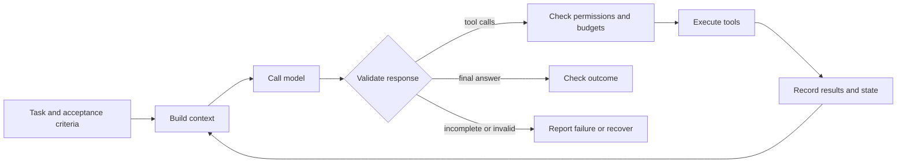

<p align="center">
  
</p>

# Agent Zero to Hero

**Build an agent harness from scratch. Learn how to tell whether it works.**

A source-first Python course: 20 foundation lessons, a new Responses API lab, and three reliability design lessons. No agent framework dependencies. Each step makes a small mechanism visible before adding another.

**October 2026 edition · sources checked 2026-10-26.** Start with the [field guide](docs/FIELD_GUIDE_2026.md) for what's changed, [update notes](docs/UPDATE_2026.md) for this revision, or the [中文更新说明](docs/UPDATE_2026.zh-CN.md).

The original course's strength is its progression from one model call to a usable coding harness. This edition keeps that progression and makes the boundaries explicit: a successful demo is not a quality evaluation, a transcript is not durable execution, and a prompt is not an access-control mechanism.

## start offline

Requires **Python 3.10+**. From the repository root:

```bash
python3 --version
python3 -m venv .venv
source .venv/bin/activate                 # Windows: .venv\Scripts\activate
python -m pip install -e ".[test]"
python -m pytest tests/ -q
python -m ruff check .
```

The tests use mocks and a local MCP subprocess. They need no API key. The [validation record](docs/VALIDATION.md) records the environment tested for this update; it does not certify live model quality or account access.

For an opt-in live foundation demo:

```bash
export ANTHROPIC_API_KEY='your-key'
python -m chapters.ch00_welcome "what is 17 * 23?"
```

For the new Responses lab, set an available compatible model explicitly:

```bash
export OPENAI_API_KEY='your-key'
export OPENAI_MODEL='your-supported-model-id'
python -m chapters.ch17b_responses
```

Live calls incur provider charges. Before using the capstone, read [its permission boundary](chapters/ch19_permissions.md): `agent.py` can read files and execute a shell with the access of its process. Use an inspected, disposable workspace for experiments.

## the loop is the beginning

```python
# Conceptual pseudocode: see the chapters for provider-specific details.
for step in range(step_budget):
    response = call_model(context, tools)
    validate_completion_and_tool_calls(response)
    context.append(response)
    if response.is_final:
        return verify_outcome(response)
    context.extend(execute_authorized_tools(response.tool_calls))
```

The shared idea is model → tools → observations → model. A useful harness also owns state, permissions, limits, recovery, and evidence of completion. Commercial coding agents contain much more than this sketch.



## choose a reading path

| Reader | Start here | Result |
|---|---|---|
| New to agents; comfortable with Python | 00 → 05, then 06 → 10 | Explain and debug the tool loop |
| Returning reader | [Field guide](docs/FIELD_GUIDE_2026.md) → 17b → 18–20 | Understand current interfaces and reliability gaps |
| Building a product | 18 → 19 → 20, then inspect `agent.py` | Write acceptance tests, authority rules, and a recovery design |
| Teaching a class | [SYLLABUS.md](SYLLABUS.md) | Seven-week core plus optional reliability extension |

## foundation: inspect, run, break, explain

Foundation lessons have paired Python and Markdown files. Historical API/protocol examples are labelled where relevant; model availability and pricing must be checked before a live run.

| # | Chapter | What you'll learn |
|---|---|---|
| 00 | [welcome](chapters/ch00_welcome.md) | A complete working agent in 30 lines. The whole shape, in 5 minutes. |
| 01 | [raw_call](chapters/ch01_raw_call.md) | One HTTP POST. The Messages API. No SDK. |
| 02 | [messages_array](chapters/ch02_messages_array.md) | Application-managed history for the stateless Messages API. |
| 03 | [stop_reasons](chapters/ch03_stop_reasons.md) | Foundation termination states and explicit handling of unknown states. |
| 04 | [one_tool](chapters/ch04_one_tool.md) | The `tool_use` → `tool_result` protocol. One round-trip. |
| **05** | **[the_loop](chapters/ch05_the_loop.md)** | **THE LOOP.** Six lines. Decomposition, ReAct, planning. The pivot chapter. |
| 06 | [parallel_tools](chapters/ch06_parallel_tools.md) | Multiple tool_use blocks in one turn. The single-user-message rule. |
| 07 | [errors](chapters/ch07_errors.md) | Tool errors as content. `is_error: true`. Refusals. |
| 08 | [system_prompts](chapters/ch08_system_prompts.md) | What goes in `system` vs `messages`. Persona that survives compaction. |
| 08b | [observability](chapters/ch08b_observability.md) | Estimate per-turn usage and cost; record pricing assumptions. |
| **08c** | **[prompt_caching](chapters/ch08c_prompt_caching.md)** | Stable prefixes, model-specific thresholds, TTL, measured savings. |
| 09 | [sessions](chapters/ch09_sessions.md) | JSONL on disk. Resume after `Ctrl-C`. |
| **10** | **[compaction](chapters/ch10_compaction.md)** | Summarize context while preserving important state and tool pairs. |
| 11 | [subagents](chapters/ch11_subagents.md) | Isolate exploration; measure total cost and handoff quality. |
| 12 | [skills](chapters/ch12_skills.md) | Markdown loaded on demand. Progressive disclosure. |
| **13** | **[mcp_wire](chapters/ch13_mcp_wire.md)** | A pinned 2024-11-05 stdio tools subset; current protocol differs. |
| 14 | [mcp_agent](chapters/ch14_mcp_agent.md) | Wire your own MCP server into the agent loop. |
| 15 | [streaming_text](chapters/ch15_streaming_text.md) | SSE basics. Render text deltas as they arrive. |
| 16 | [streaming_tools](chapters/ch16_streaming_tools.md) | `input_json_delta` accumulation. The hard chapter. |
| 17 | [multi_provider](chapters/ch17_multi_provider.md) | Original Anthropic / Chat Completions / generateContent adapters. |
| ★ | **[agent.py](agent.py)** | Educational coding CLI combining core primitives; see capability map below. |
| ★ | **[microsite/](microsite/)** | The capstone. Build a working website from one prompt. |


## new: from a working demo to an assessed system

| Chapter | Format | What you should be able to demonstrate |
|---|---|---|
| [17b — Responses](chapters/ch17b_responses.md) | Python + offline protocol tests | Preserve continuation and call IDs; reject incomplete responses |
| [18 — Evaluation](chapters/ch18_evaluation.md) | Design lesson + exercises | Judge environment outcomes and repeatability, not fluent answers |
| [19 — Permissions](chapters/ch19_permissions.md) | Design lesson + exercises | Separate tool descriptions, user authority, and execution policy |
| [20 — Durable execution](chapters/ch20_durable_execution.md) | Design lesson + exercises | Recover from a crash without blindly repeating an external write |

The three design lessons describe extensions to build. They do not imply those production subsystems are already implemented in the CLI.

## what is actually integrated?

| Capability | Standalone lesson | `agent.py` |
|---|---|---|
| Model/tool loop, local file tools, streaming | 00–08, 15–16 | Yes, Anthropic only |
| Conversation log and compaction | 09–10 | Yes; new snapshots replay after restart |
| Confirmation before Write/Edit/Bash | 19 explains the limits | Basic gate; no OS sandbox |
| Usage meter | 08b–08c | In-process estimate; not durable billing |
| Subagents | 11 | Exercise, not integrated |
| Skills discovery/loading | 12 | Exercise, not integrated |
| MCP connection | 13–14 | Separate legacy-protocol demo |
| Multiple providers / Responses | 17 / 17b | Separate examples |
| Outcome evaluation / transactional recovery | 18 / 20 | Design exercises, not production features |

## documentation map

- [2026 field guide](docs/FIELD_GUIDE_2026.md): architecture, state, interoperability, and tool economics.
- [Provider adaptation](docs/ADAPTING.md): original adapter limitations and current API paths.
- [MCP version boundary](docs/MCP_VERSIONS.md): the pinned lab versus today's stable specification.
- [Sources](docs/SOURCES.md): primary references, dates, status, and implications.
- [FAQ](docs/FAQ.md), [validation](docs/VALIDATION.md), [remaining work](docs/WISHLIST.md), and [exam key](docs/EXAM_KEY.md).

Costs and performance are measured properties of a configuration, not promises printed on the cover. Record model ID, SDK, task, retries, cache use, and output size when comparing runs. Original illustrations and promotional media are retained as historical course assets; their embedded counts or price slogans may predate this edition.

## about the course

Written by **[Ke Wang](https://github.com/KeWang0622)**. GuiGui 🐢 remains the course mascot. The course is inspired by readable educational repositories such as Karpathy's [micrograd](https://github.com/karpathy/micrograd), and by public documentation and implementations across the agent ecosystem.

MIT licensed. See [LICENSE](LICENSE). Contributions should preserve small, inspectable lessons; read [CONTRIBUTING.md](CONTRIBUTING.md).
